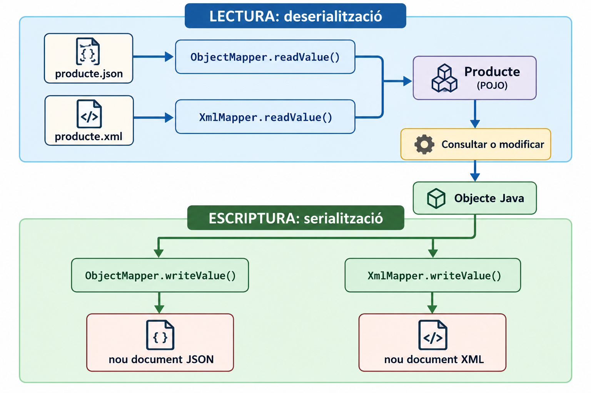

# Mapejant JSON i XML amb Jackson 3

Ja sabem observar un document JSON o XML i crear les classes Java que el representen. Ara farem el pas següent: **llegir el document per a obtindre objectes Java i escriure objectes Java en un document**.

Treballarem amb **Java 21 i Jackson 3**. Els exemples utilitzen Jackson **3.2.4** i mantenen les versions de JSON i XML iguals. 


Ja hem dissenyat els POJOs observant documents. Ara farem que el programa:

1. Llija un document i construïsca els objectes corresponents.
2. Consulte i modifique les dades d'aquests objectes.
3. Escriga els objectes de nou en format JSON o XML.

**Java 21 és la versió triada per als exemples de classe.** Jackson 3 requereix com a mínim Java 17; el fet de treballar amb Java 21 és una decisió del projecte, no una obligació de Jackson.


## 1. Què és mapejar amb Jackson?

Jackson relaciona les propietats d’un document amb els camps d’una classe Java.

| Procés              | Direcció                | Exemple                                         |
| ------------------- | ----------------------- | ----------------------------------------------- |
| **Deserialització** | JSON/XML → objecte Java | Llegir `producte.json` i obtindre un `Producte` |
| **Serialització**   | Objecte Java → JSON/XML | Guardar un `Producte` en `producte.json`        |

Per a fer-ho utilitzarem dos classes:

| Format | Classe de Jackson |
| ------ | ----------------- |
| JSON   | `ObjectMapper`    |
| XML    | `XmlMapper`       |

### Esquema general del mapeig



- El **document** proporciona les dades, el **mapper** fa la conversió i el **POJO** les representa en Java. En els dos sentits treballem amb els mateixos objectes.

### Les tres peces que intervindran

| Peça     | Què representa?                                                     | Exemple                                  |
| -------- | ------------------------------------------------------------------- | ---------------------------------------- |
| Document | Dades escrites en JSON o XML                                        | `{"nom":"Ratolí"}` o `<nom>Ratolí</nom>` |
| POJO     | Estructura Java on guardarem les dades                              | `Producte`, amb el camp `String nom`     |
| Mapper   | Objecte de Jackson que transforma dades entre el document i el POJO | `ObjectMapper` o `XmlMapper`             |

- Quan llegim, Jackson **interpreta el document**, busca les propietats que reconeix en el POJO, crea els objectes necessaris i assigna els valors. 
- Quan escrivim, obté els valors de l'objecte Java i genera el text del document. No hem de buscar les claus ni construir les etiquetes una a una.

**Regla inicial de mapeig:** els noms i tipus han de ser compatibles. Per exemple, `"preu": 24.99` pot omplir `double preu`; `"actiu": true` pot omplir `boolean actiu`. Si el document conté un objecte dins d'un altre, el camp Java ha de ser un altre POJO. Si conté una llista, necessitarem una col·lecció com `List<Producte>`.

Jackson treballa amb **propietats Java**, que en els exemples reconeix a través dels **getters** i **setters** dels POJOs. El **constructor buit** li facilita crear l'objecte en aquesta manera de programar. 

> **Recorda:** aquesta serialització genera **text JSON o XML**. No és la serialització binària de Java amb `ObjectOutputStream`, i els nostres POJOs no necessiten implementar `Serializable`.

---

## 2. Dependències i imports per a Jackson 3

Maven i l'estructura del projecte ja s'han explicat en els apunts d'introducció. Per a practicar el mapeig, utilitzarem el projecte IntelliJ preparat: el seu `pom.xml` inclou `jackson-databind` per a JSON i `jackson-dataformat-xml` per a XML. Les dos dependències utilitzen la mateixa versió de Jackson 3.


### Imports de Jackson 3

Cal distingir els paquets:

| Què necessitem?             | Import                                      |
| --------------------------- | ------------------------------------------- |
| Mapper JSON                 | `tools.jackson.databind.ObjectMapper`       |
| Mapper XML                  | `tools.jackson.dataformat.xml.XmlMapper`    |
| Anotacions comunes          | `com.fasterxml.jackson.annotation.*`        |
| Anotacions específiques XML | `tools.jackson.dataformat.xml.annotation.*` |

**Atenció:** en Jackson 3, els mappers passen a `tools.jackson`, però les anotacions comunes, com `@JsonProperty` i `@JsonFormat`, continuen en `com.fasterxml.jackson.annotation`. 

---

# Part I. Mapeig de JSON

## 3. `ObjectMapper`: classe i mètodes per a mapar JSON

### Què és `ObjectMapper`?

`ObjectMapper` és una classe de Jackson que permet **deserialitzar dades JSON a objectes Java** i **serialitzar objectes Java a JSON**. No està associada a cap POJO concret: el mateix mapper pot treballar amb `Producte`, `Alumne`, `Cataleg` o altres classes compatibles.

```java
ObjectMapper mapper = new ObjectMapper();
```

### Mètodes principals d'`ObjectMapper`

En esta taula, `T` representa **el tipus Java que volem obtindre**; `tipus.class` és la classe que indiquem en la lectura (per exemple, `Producte.class` o `Alumne.class`). `objecte` pot ser qualsevol objecte que Jackson puga serialitzar.

| Retorn | Mètode (ús genèric) | Què fa? |
| --- | --- | --- |
| `T` | `readValue(textJson, tipus.class)` | Interpreta una `String` amb JSON i retorna un objecte del tipus indicat. |
| `T` | `readValue(fitxerEntrada, tipus.class)` | Llig el JSON d'un `File` i retorna un objecte del tipus indicat. |
| `String` | `writeValueAsString(objecte)` | Retorna el JSON generat com a text, sense crear un fitxer. |
| `void` | `writeValue(fitxerEixida, objecte)` | Escriu el JSON en un fitxer (`File`). |
| `ObjectWriter` | `writerWithDefaultPrettyPrinter()` | Retorna un escriptor configurat per a produir JSON indentat; encara no escriu res. |

**Important:** el retorn de `readValue()` és un objecte del tipus indicat, es a dir, si indiquem `Alumne.class`, retorna un `Alumne`; si indiquem `Cataleg.class`, un `Cataleg`. En la taula, `T` és una manera abreujada de representar eixe tipus variable, no el nom d'una classe real.


### Primer exemple: llegir i escriure una `String` JSON

Ara aplicarem els mètodes a la classe `Producte`. En este primer programa només necessitarem `readValue` i `writeValueAsString`, sense utilitzar fitxers.

Partim d’aquest JSON:

```json
{
  "nom": "Ratolí Gamer",
  "preu": 24.99,
  "actiu": true
}
```

Ja sabem crear el POJO corresponent.

### `Producte.java`

En els POJOs dels apunts indiquem `// Getters i Setters` per a no repetir codi que ja sabeu generar amb IntelliJ. **Abans d'executar els fragments, genereu aquests mètodes**. El projecte Maven adjunt els conté complets.

```java
public class Producte {

    private String nom;
    private double preu;
    private boolean actiu;

    public Producte() {
    }

    public Producte(String nom, double preu, boolean actiu) {
        this.nom = nom;
        this.preu = preu;
        this.actiu = actiu;
    }

    // Getters i Setters
}
```

En aquest model senzill, Jackson pot crear un `Producte` amb el **constructor buit** i assignar-li després els valors mitjançant els *setters*. Els *getters* li permeten obtindre els valors quan escriu el JSON.

### `PrimerJackson.java`

```java
import tools.jackson.databind.ObjectMapper;

public class PrimerJackson {

    public static void main(String[] args) throws Exception {

        String json = """
                {
                  "nom": "Ratolí Gamer",
                  "preu": 24.99,
                  "actiu": true
                }
                """;

        ObjectMapper mapper = new ObjectMapper();

        // JSON → objecte Java
        Producte producte = mapper.readValue(json, Producte.class);

        System.out.println("Nom: " + producte.getNom());
        System.out.println("Preu: " + producte.getPreu());
        System.out.println("Actiu: " + producte.isActiu());

        // Objecte Java → JSON
        String jsonGenerat = mapper.writeValueAsString(producte);

        System.out.println("JSON generat:");
        System.out.println(jsonGenerat);
    }
}
```

La línia més important de la lectura és:

```java
Producte producte = mapper.readValue(json, Producte.class);
```

Li indiquem a Jackson **quin text ha de llegir** i **quina classe ha de crear**.

Per a fer el camí contrari:

```java
String jsonGenerat = mapper.writeValueAsString(producte);
```

El resultat queda en una `String`. **Encara no hem creat cap fitxer.**

### Al codi anterior

```java
Producte producte = mapper.readValue(json, Producte.class);
```

- `mapper` és l'eina de conversió.
- `json` conté el text que volem interpretar. **No és el nom d'un fitxer.**
- `Producte.class` indica a Jackson quina classe ha de crear; no és un objecte `Producte`.
- El resultat és l'objecte Java que guardem en la variable `producte`.


> `new ObjectMapper()` continua sent vàlid en Jackson 3 quan no necessitem configurar-lo.
---

## 4. Llegir i escriure fitxers JSON

Ara el JSON estarà en un fitxer real.

Creem `dades/producte.json`:

```json
{
  "nom": "Ratolí Gamer",
  "preu": 24.99,
  "actiu": true
}
```

### `LligIEscriuJSON.java`

```java
import java.io.File;
import tools.jackson.databind.ObjectMapper;

public class LligIEscriuJSON {

    public static void main(String[] args) throws Exception {

        ObjectMapper mapper = new ObjectMapper();

        File entrada = new File("dades/producte.json");

        // Llegim el fitxer i obtenim un objecte Java.
        Producte producte = mapper.readValue(entrada, Producte.class);

        System.out.println("Producte llegit: " + producte.getNom());
        System.out.println("Preu anterior: " + producte.getPreu());

        // Modifiquem l'objecte en memòria.
        producte.setPreu(29.99);

        // Escrivim l'objecte en un altre fitxer JSON.
        File eixida = new File("dades/producte_modificat.json");
        mapper.writeValue(eixida, producte);

        System.out.println("Preu nou: " + producte.getPreu());
        System.out.println("Fitxer guardat en: " + eixida.getAbsolutePath());
    }
}
```

Ara apliquem els mateixos mètodes a fitxers. La diferència respecte de l’apartat anterior és el **primer argument**:

| Crida                                | Què llig o escriu?          |
| ------------------------------------ | --------------------------- |
| `readValue(json, Producte.class)`    | El contingut d’una `String` |
| `readValue(entrada, Producte.class)` | El contingut d’un fitxer    |
| `writeValueAsString(producte)`       | Retorna una `String`        |
| `writeValue(eixida, producte)`       | Escriu en un fitxer         |

`writeValue` crea el fitxer d’eixida si no existeix i en substitueix el contingut si ja existeix. En aquest exemple, `producte.json` continua amb el preu original; el canvi es guarda en `producte_modificat.json`.

**Matís important:** `writeValue` pot crear el **fitxer**, però no crea automàticament les carpetes que falten en la ruta. Per això hem creat `dades/` abans d'executar els exemples. El `File` representa la ruta; els bytes es lligen o s'escriuen quan cridem el mètode del mapper.

> **Important:** `readValue("dades/producte.json", Producte.class)` intentaria interpretar eixe text com a **JSON**, no com una ruta. Per a llegir el fitxer hem passat un `File`.


---

## 5. Objectes dins d’objectes i llistes

### Primer: un objecte dins d'un altre

Abans de treballar amb llistes, fixem-nos en un objecte JSON imbricat:

```json
{
  "nom": "Associació Joc Jove",
  "contacte": {
    "correu": "info@jocjove.org",
    "telefon": "964123456"
  }
}
```

La propietat `contacte` **no és una cadena ni una llista**: és un objecte. Per això creem un POJO `Contacte` i, dins de `Organitzador`, un camp `Contacte contacte`. No cal una classe per al nom o el telèfon perquè són valors simples.

`Contacte.java`:

```java
public class Contacte {
    private String correu;
    private String telefon;

    public Contacte() {}

    // Getters i Setters
}
```

`Organitzador.java`:

```java
public class Organitzador {
    private String nom;
    private Contacte contacte;

    public Organitzador() {}

    // Getters i Setters
}
```

`LligOrganitzador.java`:

```java
import tools.jackson.databind.ObjectMapper;

public class LligOrganitzador {
    public static void main(String[] args) throws Exception {
        String json = """
                {
                  "nom": "Associació Joc Jove",
                  "contacte": {
                    "correu": "info@jocjove.org",
                    "telefon": "964123456"
                  }
                }
                """;

        ObjectMapper mapper = new ObjectMapper();
        Organitzador organitzador = mapper.readValue(json, Organitzador.class);

        System.out.println("Nom: " + organitzador.getNom());
        System.out.println("Correu: " + organitzador.getContacte().getCorreu());
    }
}
```

La primera crida a un getter recupera l'objecte `Contacte`; la segona recupera el seu `correu`. Aquestes classes ens resultaran familiars quan arribem al cas pràctic de la fira.

---

## 6. Anotacions comunes: quan els noms o els valors requereixen ajustos

Fins ara, els noms Java i els noms JSON coincidien. En documents reals pot aparéixer `nom_usuari` en el JSON, mentre que en Java preferim un camp `nom`.

Les **anotacions** indiquen a Jackson com ha de tractar aquestes diferències.

### Què canvia una anotació?

Fins ací, Jackson ha pogut deduir el mapeig pels noms dels getters, setters i propietats. Una anotació és una instrucció que posem en una classe, camp o mètode perquè **una propietat concreta** es tracte d'una altra manera. No cal anotar tots els camps: els que coincideixen amb el document continuen funcionant sense anotacions.

Per exemple, el camp Java `nom` i la clau JSON `nom_usuari` no tenen el mateix nom. Amb `@JsonProperty("nom_usuari")` indiquem la correspondència tant en llegir com en escriure. Aquesta anotació és comuna i pot afectar també la representació XML del mateix POJO; les anotacions `@JacksonXml...` afegeixen les decisions pròpies de l'XML.

| Anotació                 | Funció principal                                  |
| ------------------------ | ------------------------------------------------- |
| `@JsonProperty("nom")`   | Indica el nom de la propietat en el document      |
| `@JsonIgnore`            | Exclou una propietat de la lectura i l’escriptura |
| `@JsonInclude(NON_NULL)` | Omet propietats amb valor `null` en escriure      |
| `@JsonFormat(...)`       | Indica un format, per exemple per a una data      |

Aquestes són anotacions **comunes de Jackson**; no són exclusives de JSON.

### Exemple: `Usuari.java`

```java
import com.fasterxml.jackson.annotation.JsonIgnore;
import com.fasterxml.jackson.annotation.JsonInclude;
import com.fasterxml.jackson.annotation.JsonProperty;

@JsonInclude(JsonInclude.Include.NON_NULL)
public class Usuari {

    @JsonProperty("nom_usuari")
    private String nom;

    private String correu;

    @JsonIgnore
    private String contrasenya;

    public Usuari() {
    }

    public Usuari(String nom, String correu, String contrasenya) {
        this.nom = nom;
        this.correu = correu;
        this.contrasenya = contrasenya;
    }

    // Getters i Setters
}
```

### `ProvaAnotacions.java`

```java
import tools.jackson.databind.ObjectMapper;

public class ProvaAnotacions {

    public static void main(String[] args) throws Exception {

        ObjectMapper mapper = new ObjectMapper();

        Usuari usuari = new Usuari("Anna", null, "secret");

        String json = mapper.writerWithDefaultPrettyPrinter()
                .writeValueAsString(usuari);

        System.out.println(json);

        String jsonRebut = """
                {
                  "nom_usuari": "Pau",
                  "correu": "pau@example.org",
                  "contrasenya": "1234"
                }
                """;

        Usuari llegit = mapper.readValue(jsonRebut, Usuari.class);

        System.out.println("Usuari llegit: " + llegit.getNom());
        System.out.println("Correu: " + llegit.getCorreu());
    }
}
```

El primer JSON contindrà `nom_usuari`. No contindrà `correu`, perquè és `null`, ni `contrasenya`, perquè porta `@JsonIgnore`:

```json
{
  "nom_usuari" : "Anna"
}
```

En la lectura de `jsonRebut`, Jackson associa `nom_usuari` amb el camp Java `nom`. La contrasenya del JSON s’ignora.

**Diferència important entre les anotacions:**

- `NON_NULL` omet només els valors `null`.
- `NON_EMPTY` també permet ometre valors buits, com una cadena buida o una col·lecció buida.
- `@JsonIgnore` exclou la propietat encara que tinga un valor.

En Jackson 3, els camps desconeguts del document s’ignoren per defecte. Més endavant podem estudiar `@JsonIgnoreProperties`, però no el necessitem per a aquests primers exemples. Tampoc convé donar per garantit l’ordre de les propietats del JSON: per a llegir-lo importen els **noms**, no l’ordre. [GitHub](https://github.com/FasterXML/jackson/wiki/Jackson-Release-3.0?utm_source=chatgpt.com)

### Un error que pot passar desapercebut

Si el JSON porta `"preuu": 24.99` però el POJO espera `preu`, Jackson 3 ignora per defecte la clau desconeguda `preuu`. L'objecte es pot crear amb `preu == 0.0`, el valor inicial d'un `double`. **Que no hi haja una excepció no significa que les dades s'hagen llegit bé.** Després de `readValue`, mostreu i comproveu almenys els camps importants.

**Ampliació opcional (configuració avançada):** si voleu detectar claus desconegudes en la lectura, aquesta configuració fa que Jackson done error en trobar-les:

```java
import tools.jackson.databind.DeserializationFeature;
import tools.jackson.databind.json.JsonMapper;

JsonMapper mapper = JsonMapper.builder()
        .enable(DeserializationFeature.FAIL_ON_UNKNOWN_PROPERTIES)
        .build();
```

No és necessària per als primers programes; serveix per a comprovar el mapeig quan no sabem per què un camp queda buit.


> `@JsonIgnore` impedeix tant llegir com escriure la propietat en aquest exemple. Si una aplicació necessitara rebre una contrasenya però no tornar-la en l'eixida, faria falta una configuració diferent; no utilitzaríem `@JsonIgnore` per a eixe objectiu.

---

# Part II. Mapeig d’XML

## 7. Llegir i escriure XML amb el mateix POJO

### Què és `XmlMapper`?

`XmlMapper` és la versió del mapper preparada per a **interpretar XML i construir POJOs**, o per a **convertir POJOs en XML**. Comparteix els mètodes principals amb `ObjectMapper`, però utilitza la sintaxi XML: elements, atributs i etiquetes d'arrel.

```java
XmlMapper mapper = new XmlMapper();
```

La diferència entre els dos mappers és el **format del contingut** que processen. No és suficient canviar el nom d'un fitxer de `.json` a `.xml`: cal utilitzar el mapper corresponent.

### Mètodes d'`XmlMapper`

Els **mètodes i els tipus retornats són els mateixos que en la taula genèrica de l’apartat 3**. La diferència és el format: `XmlMapper` interpreta i genera XML en lloc de JSON. Per exemple, `readValue(fitxerEntrada, Animal.class)` retorna un `Animal`, mentre que `readValue(fitxerEntrada, Zoologic.class)` retorna un `Zoologic`.

Per defecte, una propietat senzilla com `nom` es representa amb l'element `<nom>...</nom>`. Si volem que siga un **atribut**, caldrà indicar-ho. Amb les llistes també hem de distingir entre un contenidor que agrupa els elements i elements repetits directament dins del pare.

`XmlMapper` està pensat per a mapar estructures XML a objectes. No és un validador de DTD o XSD ni un substitut general de totes les eines de processament XML. En aquests apunts treballarem amb documents d'estructura coneguda i POJOs que la representen.


Tornem a `Producte.java`. Ara creem `dades/producte.xml`:

```xml
<Producte>
    <nom>Ratolí Gamer</nom>
    <preu>24.99</preu>
    <actiu>true</actiu>
</Producte>
```

La classe `Producte` continua servint perquè les etiquetes internes coincideixen amb les seues propietats.

### `LligIEscriuXML.java`

```java
import java.io.File;
import tools.jackson.dataformat.xml.XmlMapper;

public class LligIEscriuXML {

    public static void main(String[] args) throws Exception {

        XmlMapper mapper = new XmlMapper();

        File entrada = new File("dades/producte.xml");
        Producte producte = mapper.readValue(entrada, Producte.class);

        System.out.println("Producte llegit: " + producte.getNom());

        producte.setPreu(27.50);

        File eixida = new File("dades/producte_modificat.xml");
        mapper.writeValue(eixida, producte);

        System.out.println("XML guardat en: " + eixida.getAbsolutePath());
    }
}
```

Observeu el paral·lelisme:

| JSON              | XML               |
| ----------------- | ----------------- |
| `ObjectMapper`    | `XmlMapper`       |
| `readValue(...)`  | `readValue(...)`  |
| `writeValue(...)` | `writeValue(...)` |

`new XmlMapper()` també és vàlid en Jackson 3. Només necessitarem `XmlMapper.builder()` quan vulguem configurar opcions del mapper. [GitHub](https://github.com/FasterXML/jackson-dataformat-xml/blob/3.x/README.md?utm_source=chatgpt.com)

> En aquest exemple senzill podem reutilitzar el POJO directament. Quan l’XML tinga **atributs** o **llistes amb contenidors**, haurem d’indicar a Jackson com és l’estructura exacta.


Una declaració com `<?xml version="1.0" encoding="UTF-8"?>` pot aparéixer en un XML, però no és necessària per a llegir els exemples. `XmlMapper` no l'afig per defecte en escriure; el contingut continua sent XML vàlid.

---

## 8. XML: arrel, atributs i elements repetits

### Llegim l'estructura abans d'anotar el POJO

En XML, `<animal tipus="ocell"><nom>Lloro</nom></animal>` conté informació de dos maneres diferents: `tipus` és un **atribut** de l'element `animal`, mentre que `nom` és un **subelement**. Les dos dades acabaran en camps Java, però l'anotació de l'atribut és necessària perquè Jackson respecte eixa forma en escriure el document.

En canvi, un grup d'elements repetits es representa amb una `List`. La pregunta addicional és: **hi ha una etiqueta que envolta tota la llista?** Observeu els dos patrons en el document següent abans de llegir les classes.


Fixem-nos en aquest document `dades/zoologic.xml`:

```xml
<zoologic codi="Z-1">
    <animals>
        <animal tipus="mamífer">
            <nom>Lleó</nom>
        </animal>
        <animal tipus="ocell">
            <nom>Lloro</nom>
        </animal>
    </animals>
    <avis>Obert dissabte</avis>
    <avis>Última entrada a les 18 h</avis>
</zoologic>
```

Abans de programar, analitzem-ne l’estructura:

| Part de l’XML                                 | Representació Java                     |
| --------------------------------------------- | -------------------------------------- |
| `<zoologic>`                                  | Classe `Zoologic`                      |
| `codi="Z-1"`                                  | Camp `String codi`, com a atribut XML  |
| `<animals>...</animals>`                      | Contenidor de la llista                |
| Diversos `<animal>`                           | `List<Animal>`                         |
| `tipus="mamífer"`                             | Camp `String tipus`, com a atribut XML |
| Diversos `<avis>` directament dins de l’arrel | `List<String>` sense contenidor        |

### `Animal.java`

```java
import tools.jackson.dataformat.xml.annotation.JacksonXmlProperty;

public class Animal {

    @JacksonXmlProperty(isAttribute = true)
    private String tipus;

    private String nom;

    public Animal() {
    }

    public Animal(String tipus, String nom) {
        this.tipus = tipus;
        this.nom = nom;
    }

    // Getters i Setters
}
```

Sense `isAttribute = true`, Jackson representaria `tipus` com un element `<tipus>`, en lloc de l’atribut `tipus="..."`.

### `Zoologic.java`

```java
import java.util.List;
import com.fasterxml.jackson.annotation.JsonRootName;
import tools.jackson.dataformat.xml.annotation.JacksonXmlElementWrapper;
import tools.jackson.dataformat.xml.annotation.JacksonXmlProperty;

@JsonRootName("zoologic")
public class Zoologic {

    @JacksonXmlProperty(isAttribute = true)
    private String codi;

    @JacksonXmlElementWrapper(localName = "animals")
    @JacksonXmlProperty(localName = "animal")
    private List<Animal> animals;

    @JacksonXmlElementWrapper(useWrapping = false)
    @JacksonXmlProperty(localName = "avis")
    private List<String> avisos;

    public Zoologic() {
    }

    public Zoologic(String codi, List<Animal> animals,
                     List<String> avisos) {
        this.codi = codi;
        this.animals = animals;
        this.avisos = avisos;
    }

    // Getters i Setters
}
```

Hi ha **dos decisions de disseny diferents** per a les llistes:

```java
@JacksonXmlElementWrapper(localName = "animals")
@JacksonXmlProperty(localName = "animal")
private List<Animal> animals;
```

Açò correspon a:

```xml
<animals>
    <animal>...</animal>
    <animal>...</animal>
</animals>
```

En canvi:

```java
@JacksonXmlElementWrapper(useWrapping = false)
@JacksonXmlProperty(localName = "avis")
private List<String> avisos;
```

Correspon a:

```xml
<avis>Obert dissabte</avis>
<avis>Última entrada a les 18 h</avis>
```

**No hi ha cap etiqueta `<avisos>`**. Per això indiquem `useWrapping = false`. En Jackson XML, les col·leccions tenen contenidor per defecte; no hem de confiar que llevar l’anotació elimine el contenidor. [GitHub](https://github.com/FasterXML/jackson-dataformat-xml/blob/3.x/CLAUDE.md?utm_source=chatgpt.com)

`@JsonRootName("zoologic")` indica el nom de l’arrel quan escrivim l’XML. En Jackson 3 és la forma recomanada per a aquest cas; `@JacksonXmlRootElement` està obsoleta. [FasterXML/jackson-dataformat-xml](https://github.com/FasterXML/jackson-dataformat-xml/blob/3.x/CLAUDE.md?utm_source=chatgpt.com)

### `LligZoologicXML.java`

```java
import java.io.File;
import tools.jackson.dataformat.xml.XmlMapper;

public class LligZoologicXML {

    public static void main(String[] args) throws Exception {

        XmlMapper mapper = new XmlMapper();

        Zoologic zoologic = mapper.readValue(
                new File("dades/zoologic.xml"),
                Zoologic.class
        );

        System.out.println("Codi: " + zoologic.getCodi());

        for (Animal animal : zoologic.getAnimals()) {
            System.out.println(animal.getNom()
                    + " (" + animal.getTipus() + ")");
        }

        for (String avis : zoologic.getAvisos()) {
            System.out.println("Avís: " + avis);
        }

        mapper.writeValue(
                new File("dades/zoologic_copia.xml"),
                zoologic
        );
    }
}
```

**Idea principal:** primer decidim quines classes i llistes representen el document. Després afegim només les anotacions necessàries per a expressar els detalls propis de l’XML.

### Què controla cada anotació en aquest exemple?

| Anotació                                           | Decisió que expressa                                                                                                  |
| -------------------------------------------------- | --------------------------------------------------------------------------------------------------------------------- |
| `@JsonRootName("zoologic")`                        | Nom de l'element arrel **en escriure** un `Zoologic`. No és, per si sola, una validació del nom de l'arrel d'entrada. |
| `@JacksonXmlProperty(isAttribute = true)`          | El valor és un atribut XML, com `codi="Z-1"` o `tipus="ocell"`.                                                       |
| `@JacksonXmlElementWrapper(localName = "animals")` | La llista va dins de l'etiqueta `<animals>`.                                                                          |
| `@JacksonXmlProperty(localName = "animal")`        | Cada membre de la llista s'escriu com a `<animal>`.                                                                   |
| `@JacksonXmlElementWrapper(useWrapping = false)`   | Els `<avis>` apareixen seguits, sense etiqueta `<avisos>`.                                                            |


---

## 9. Ampliació opcional: dates amb `LocalDate` i format de l’eixida

> **Ampliació:** aquest apartat és opcional. Els exemples bàsics de JSON i XML dels apartats anteriors no requerixen `LocalDate` ni configurar la indentació amb `builder()`.

### El valor Java i la seua representació en el document

`LocalDate` guarda una **data sense hora** en Java. Una mateixa data es pot escriure amb formats diferents: `2026-10-27` (ISO) o `27-10-2026` (dia-mes-any). El valor de la data no canvia; canvia el **text** que apareix en JSON o XML.

Jackson 3 ja coneix `LocalDate` i, si no li indiquem cap patró, pot escriure'l com a cadena ISO. Introduïm `@JsonFormat(pattern = "dd-MM-yyyy")` perquè **aquest document concret** vol un format diferent. Així separem el tipus de dada Java de la seua representació externa.


Suposem que volem representar una data:

```json
{
  "nom": "Fira de videojocs",
  "data": "27-10-2026"
}
```

En Java utilitzarem `LocalDate`. Per a indicar el format `dia-mes-any`, aplicarem `@JsonFormat`.

### `Esdeveniment.java`

```java
import java.time.LocalDate;
import com.fasterxml.jackson.annotation.JsonFormat;

public class Esdeveniment {

    private String nom;

    @JsonFormat(pattern = "dd-MM-yyyy")
    private LocalDate data;

    public Esdeveniment() {
    }

    public Esdeveniment(String nom, LocalDate data) {
        this.nom = nom;
        this.data = data;
    }

    // Getters i Setters
}
```

### `ProvaDates.java`

```java
import java.time.LocalDate;
import tools.jackson.databind.ObjectMapper;

public class ProvaDates {

    public static void main(String[] args) throws Exception {

        ObjectMapper mapper = new ObjectMapper();

        Esdeveniment esdeveniment = new Esdeveniment(
                "Fira de videojocs",
                LocalDate.of(2026, 10, 27)
        );

        String json = mapper.writerWithDefaultPrettyPrinter()
                .writeValueAsString(esdeveniment);

        System.out.println(json);

        Esdeveniment llegit =
                mapper.readValue(json, Esdeveniment.class);

        System.out.println("Data recuperada: "
                + llegit.getData());
    }
}
```

En el JSON, la data tindrà el format definit per l’anotació:

```json
"data" : "27-10-2026"
```

Quan imprimim directament el `LocalDate` amb `getData()`, Java el mostra habitualment com `2026-10-27`. **Són dos representacions del mateix valor.**

En Jackson 3, el suport de `java.time`, inclòs `LocalDate`, forma part de `jackson-databind`: no hem d’afegir `jackson-datatype-jsr310` ni registrar `JavaTimeModule`. Sense `@JsonFormat`, el format de cadena habitual per a `LocalDate` és l’ISO, com `2026-10-27`. [GitHub](https://github.com/FasterXML/jackson/blob/main/jackson3/MIGRATING_TO_JACKSON_3.md?plain=1\&utm_source=chatgpt.com)

### Donar format llegible a l’eixida

En l’exemple hem utilitzat:

```java
mapper.writerWithDefaultPrettyPrinter()
      .writeValueAsString(esdeveniment);
```

Això formata **aquesta escriptura concreta**. Si volem configurar el mapper perquè indente totes les seues eixides, en Jackson 3 fem servir un *builder*:

```java
import tools.jackson.databind.ObjectMapper;
import tools.jackson.databind.SerializationFeature;
import tools.jackson.databind.json.JsonMapper;

ObjectMapper mapper = JsonMapper.builder()
        .enable(SerializationFeature.INDENT_OUTPUT)
        .build();
```

Amb `XmlMapper` es fa de la mateixa manera:

```java
import tools.jackson.databind.SerializationFeature;
import tools.jackson.dataformat.xml.XmlMapper;

XmlMapper mapper = XmlMapper.builder()
        .enable(SerializationFeature.INDENT_OUTPUT)
        .build();
```

### Exemple complet: XML indentat en una `String`

En el projecte IntelliJ, `ProvaFormatXML.java` mostra l'ús de `writeValueAsString` amb un `XmlMapper` configurat i, després, la lectura del text XML generat amb `readValue`:

```java
import tools.jackson.databind.SerializationFeature;
import tools.jackson.dataformat.xml.XmlMapper;

public class ProvaFormatXML {
    public static void main(String[] args) throws Exception {
        XmlMapper mapper = XmlMapper.builder()
                .enable(SerializationFeature.INDENT_OUTPUT)
                .build();

        Producte producte = new Producte("Ratolí Gamer", 24.99, true);
        String xml = mapper.writeValueAsString(producte);
        System.out.println(xml);

        Producte recuperat = mapper.readValue(xml, Producte.class);
        System.out.println("Llegit de l'XML: " + recuperat.getNom());
    }
}
```

El `builder` decideix com s'escriurà l'XML; `writeValueAsString` fa la conversió i retorna la `String`. `readValue(xml, Producte.class)` recorre el camí contrari a partir d'eixa `String`. Ací no es guarda cap fitxer. Si volguérem guardar-lo, utilitzaríem `writeValue(File, producte)`.

**Per què apareix `builder()`?** En Jackson 3 configurem el mapper **abans de construir-lo**. Podem continuar utilitzant `new ObjectMapper()` o `new XmlMapper()` quan no necessitem canviar-ne la configuració. [GitHub](https://github.com/FasterXML/jackson/blob/main/jackson3/MIGRATING_TO_JACKSON_3.md?plain=1\&utm_source=chatgpt.com)

`JsonMapper` és un mapper específic de JSON. Utilitzem el seu `builder()` quan volem activar una opció per a totes les escriptures d'aquella instància, com `INDENT_OUTPUT`. Si només volem formatar una eixida, `writerWithDefaultPrettyPrinter()` és suficient.

Els programes dels apunts declaren `throws Exception` per a centrar-se al principi en el mapeig. És una simplificació dels exemples, no una regla de Jackson. En una aplicació completa tractaríem de manera diferenciada un fitxer inaccessible, un document mal format o unes dades que no encaixen en el POJO.


---

## 10. Resum i comprovacions del mapeig

En llegir i escriure JSON o XML, cal comprovar que els valors i l’estructura del document resultant són els esperats.

### Taula ràpida de decisions

| Si necessite... | Utilitze... |
| --- | --- |
| Llegir JSON | `ObjectMapper.readValue()` |
| Llegir XML | `XmlMapper.readValue()` |
| Guardar JSON o XML en un fitxer | `writeValue()` amb el mapper corresponent |
| Obtindre el document com a text | `writeValueAsString()` |
| Representar un objecte imbricat | Un altre POJO |
| Representar diversos elements | `List<T>` |
| Canviar el nom d'una propietat | `@JsonProperty` |
| Ignorar una propietat | `@JsonIgnore` |
| Ometre valors `null` | `@JsonInclude(NON_NULL)` |
| Donar format a una data (ampliació) | `@JsonFormat` |
| Indicar el nom de l'arrel XML | `@JsonRootName` |
| Representar un atribut XML | `@JacksonXmlProperty(isAttribute = true)` |
| Configurar el contenidor d'una llista XML | `@JacksonXmlElementWrapper` |

### Errors habituals i per on començar a buscar

| Què observem?                                            | Primera comprovació                                                                                           |
| -------------------------------------------------------- | ------------------------------------------------------------------------------------------------------------- |
| Els imports de `tools.jackson...` apareixen en roig      | Revisar el `pom.xml`, la versió de Java i actualitzar Maven en IntelliJ.                                      |
| No es troba `dades/producte.json`                        | Comprovar que existeix `dades/` a l'arrel i que IntelliJ usa l'arrel del projecte com a directori de treball. |
| Un getter retorna `null` o `0.0`                         | Comparar el nom i el tipus del camp amb el document; els camps desconeguts poden quedar ignorats.             |
| L'XML escrit té una etiqueta addicional per a una llista | Comprovar si la llista ha de portar `@JacksonXmlElementWrapper(useWrapping = false)`.                         |
| Un atribut XML acaba com a subelement                    | Comprovar `@JacksonXmlProperty(isAttribute = true)`.                                                          |
| No apareix la declaració inicial `<?xml ...?>`           | La declaració no s'emet per defecte; el document pot continuar sent vàlid.                                    |

Un fitxer escrit i llegit amb èxit no garanteix, per si mateix, que **tots els camps** tinguen els valors esperats. Compareu els objectes llegits i l'estructura del document resultant.

**Recordeu:** un fitxer llegit sense errors pot contindre camps amb `null` o `0.0` si el mapeig no correspon a les dades originals. Comproveu els valors importants i les llistes, no sols l'absència d'excepcions.

> **Regla de treball:** comenceu amb POJOs senzills i afegiu anotacions únicament quan una diferència entre la classe i el document ho requerisca.

---

## 11. Per a més endavant

Jackson té altres possibilitats, però no les necessitem per a aprendre el mapeig bàsic amb POJOs:

- **`JsonNode`** permet llegir un JSON com un arbre quan no volem crear classes per a tot el document.
- **`@JsonGetter` i `@JsonSetter`** permeten diferenciar el nom utilitzat en escriure del nom acceptat en llegir.
- **`@JacksonXmlText`** representa el text directe d’un element XML, especialment útil quan l’element també té atributs.
- **`@JacksonXmlCData`** escriu text dins d’una secció CDATA. Per a text normal no és necessari: Jackson ja escapa els caràcters XML quan correspon.

**Abans d’arribar ací, l’objectiu és dominar aquesta seqüència:** observar el document, dissenyar els POJOs, llegir-lo amb `readValue`, consultar o modificar els objectes i escriure el resultat amb `writeValue`.

---

## Fonts de consulta per a aquest tema

- [Guia oficial de migració a Jackson 3](https://github.com/FasterXML/jackson/blob/main/jackson3/MIGRATING_TO_JACKSON_3.md).
- [Documentació de Jackson XML](https://github.com/FasterXML/jackson-dataformat-xml/blob/3.x/README.md).
- [Documentació del plugin de compilació de Maven](https://maven.apache.org/plugins/maven-compiler-plugin/).

Aquestes fonts amplien els conceptes del tema. Els exemples de classe continuen fixats a Java 21 i Jackson 3.2.4 perquè tots treballem amb les mateixes versions.