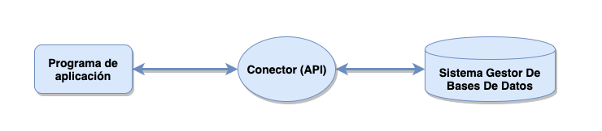
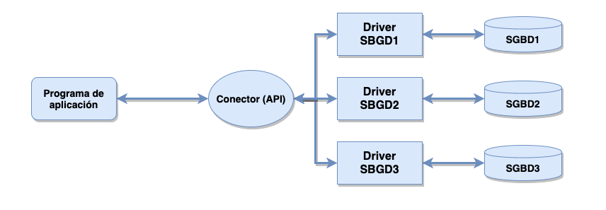
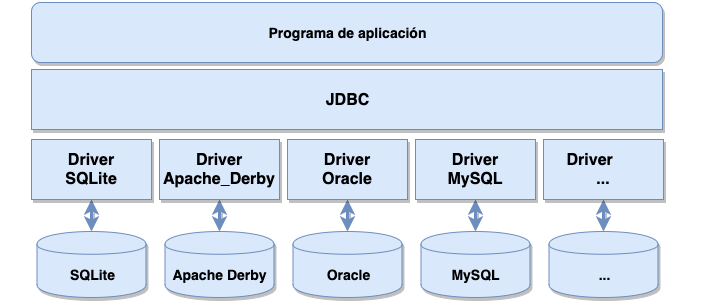
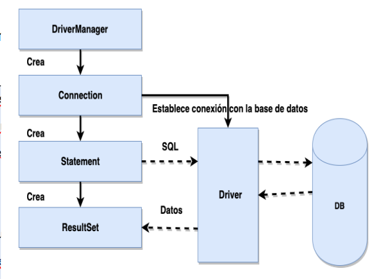

# Maneig de Connectors

**L'accés a dades** és el procés de recuperació o manipulació de dades obtingudes des d'un origen local o remot.

**Els orígens de dades** poden ser de diversa índole:
- Una base de dades relacional.
- Un full de càlcul.
- Un fitxer de text.
- Un servei web remot.
- Etc.

En aquesta unitat ens centrarem en els orígens de dades relacionals i aprendrem a realitzar **aplicacions Java per accedir a bases de dades** relacionals mitjançant l'ús de **connectors**.

---

## 1. Connectors

Els sistemes gestors de bases de dades (**SGBD**) utilitzen **llenguatges especialitzats** per operar amb les dades que emmagatzemen. Mentrestant, les aplicacions s'escriuen en llenguatges de programació de propòsit general, com Java.

Per permetre que aquestes aplicacions es comuniquen amb els SGBD, es **necessiten mecanismes específics**. Aquests mecanismes es desenvolupen com a **APIs** i es denominen **connectors**.

---

{: .text-center}


---


#### Característiques dels connectors:

- Per treballar amb bases de dades relacionals (**RDBMS**), s'utilitza el llenguatge **SQL**.
- Cada RDBMS té la seva pròpia **versió de SQL** (dialectes SQL) amb peculiaritats específiques, 
requerint així estructures de baix nivell personalitzades.

L'ús de **drivers** permet **desenvolupar una arquitectura genèrica**. Els connectors defineixen una interfície 
comú entre les aplicacions i les bases de dades, 
mentre que els drivers s'encarreguen de gestionar les particularitats de cada base de dades.

---

{: .text-center}


---


Així, el connector no és només una API, sinó una **arquitectura** que especifica **les interfícies que han d'implementar els diferents drivers** per accedir a les bases de dades.

---

#### Arquitectures de connectors:

- **ODBC (Open Database Connectivity)**: Defineix una API per obrir connexions amb bases de dades, enviar consultes, actualitzacions, etc. Es pot utilitzar amb qualsevol servidor de bases de dades compatible. Està escrit en llenguatge C.
- **JDBC (Java Database Connectivity)**: És l'API per excel·lència per connectar bases de dades amb aplicacions Java. Ens centrarem en aquesta API en aquesta unitat.
- **OLE-DB**: Orientat a aplicacions Windows.
- **ADO**: Proporciona una interfície de nivell superior sobre proveïdors OLE DB.

Avui dia, les arquitectures més utilitzades són **ODBC** i **JDBC**, ja que són compatibles amb la majoria dels SGBD. Tot i això, ofereixen beneficis a canvi d'una major complexitat de programació.

---

## 2. JDBC – Accés a Bases de Dades Relacionals

JDBC és una API que permet accedir a fonts de dades relacionals SQL des d'aplicacions Java. 
Esta arquitectura ofereix una interfície comú perquè els fabricants de SGBD pugen crear drivers que connecten les **aplicacions Java amb les bases de dades**.

### Característiques de JDBC:
- JDBC proporciona **interfícies comunes** per accedir a bases de dades. Cada **driver** les implementa per comunicar-se amb un gestor concret.
- Les **crides als mètodes Java** es corresponen amb **operacions SQL**, facilitant la interacció entre l'aplicació i la base de dades.

---

{: .text-center}


---


### Tasques principals amb JDBC:

JDBC inclou un **conjunt d'interfícies i classes** que permeten desenvolupar aplicacions en Java per:

1. **Connectar-se** a una base de dades.
2. **Enviar consultes** i instruccions d'actualització.
3. **Recuperar i processar resultats** d'una base de dades en resposta a aquestes consultes.


### Totes estes classes i interfícies les podem trobar al paquet `java.sql`. Les més importants són:


| Classe/Interfície      | Descripció                                                                                  |
|-------------------------|--------------------------------------------------------------------------------------------|
| **Driver**             | Permet connectar-se a una base de dades. Cada SGBD necessita un driver específic.          |
| **DriverManager**      | Gestiona els drivers instal·lats en el sistema.                                            |
| **DriverPropertyInfo** | Proporciona informació sobre el driver.                                                    |
| **Connection**         | Representa una connexió amb una base de dades. És possible tenir més d'una connexió alhora. |
| **DatabaseMetaData**   | Proporciona informació sobre la base de dades.                                             |
| **Statement**          | Executa sentències SQL sense paràmetres.                                                   |
| **PreparedStatement**  | Executa sentències SQL amb paràmetres d'entrada.                                           |
| **CallableStatement**  | Executa sentències SQL amb paràmetres d'entrada i d'eixida, com crides a procediments emmagatzemats. |
| **ResultSet**          | Conté les files resultants d'una consulta SELECT.                                          |
| **ResultSetMetaData**  | Proporciona informació sobre un ResultSet, com el nombre de columnes i els seus noms.      |

---

## 3. Passos per a utilitzar JDBC en una aplicació Java

Per connectar una aplicació Java a una base de dades amb JDBC, seguirem els següents passos:

1. Importar les classes necessàries:
2. Incorporar el driver JDBC al projecte.
3. Identificalr l'origen de dades (la BDA).
4. Crear un objecte **`Connection`**.
5. Crear un objecte **`Statement`**.
6. Executar una consulta SQL amb l'objecte **`Statement`**.
7. Recuperar el reultat de la consulta amb l'objecte **`ResultSet`**.
8. Alliberar recursos. (Per ordre invers al que s'han creat, **ResultSet, Statement, Connection**).

{: .text-center }


Resumint, per connectar una base de dates a una aplicació java amb JDBC seguirem 4 passos:


---
1. **Incorporar el driver al projecte.**
2. **Establir la connexió.**
3. **Executar sentències SQL.**
4. **Alliberar recursos.**

---

---

### 1. Incorporar el driver al projecte

Per connectar-nos a un gestor, necessitem que el seu driver JDBC estiga disponible quan executem el programa. En un projecte Maven, l’incorporem com una dependència en `pom.xml`.

Afig la dependència del gestor que utilitzes dins de `<dependencies>`. Si esta secció ja existix, incorpora-hi la dependència sense crear una segona secció. Després recarrega el projecte Maven en IntelliJ perquè descarregue la biblioteca.

**MySQL**, per a l’exemple complet de connexió i consulta:

```xml
<dependency>
    <groupId>com.mysql</groupId>
    <artifactId>mysql-connector-j</artifactId>
    <version>9.5.0</version>
</dependency>
```

**SQLite**, per als dos programes complets del final:

```xml
<dependency>
    <groupId>org.xerial</groupId>
    <artifactId>sqlite-jdbc</artifactId>
    <version>3.54.1.0</version>
</dependency>
```

**PostgreSQL**, si utilitzes el seu exemple de connexió:

```xml
<dependency>
    <groupId>org.postgresql</groupId>
    <artifactId>postgresql</artifactId>
    <version>42.7.14</version>
</dependency>
```

Maven incorpora la biblioteca al projecte. Els drivers actuals que utilitzem admeten el **registre automàtic** amb JDBC quan estan disponibles en execució; per això els exemples no necessiten una càrrega explícita del driver. Importar `java.sql` permet utilitzar l’API de Java, però no incorpora la biblioteca del gestor.

#### Nota: càrrega explícita del driver

En codi antic, o quan es vol carregar explícitament la classe, podem trobar:

```java
Class.forName("com.mysql.cj.jdbc.Driver");
```

Esta crida carrega la classe del driver MySQL, però no descarrega ni instal·la la biblioteca. Si la classe no està disponible, pot llançar `ClassNotFoundException`. És una tècnica vàlida, encara que no és necessària en els exemples actuals d’estos apunts.

---

### 2. Establir la Connexió

Per obrir una connexió amb una base de dades, utilitzem el mètode **`getConnection()`** de la classe **`DriverManager`**. La informació que hem de proporcionar depén del gestor.

#### Connexió amb un servidor: MySQL i PostgreSQL

En estos gestors, un **servidor** administra les bases de dades i atén les peticions de les aplicacions client. Pot estar en el mateix ordinador que Java o en un altre equip.

Per connectar-nos, proporcionem:

- **URL JDBC**: identifica el gestor, el servidor, el port i la base de dades.
- **Usuari**: compte amb què accedim al servidor.
- **Contrasenya**: credencial d’eixe usuari.

**Exemple amb MySQL:**

```java
Connection conn = DriverManager.getConnection(
    "jdbc:mysql://localhost:3306/empresa", "usuari", "contrasenya");
```

| Fragment de la URL | Significat |
|---|---|
| `jdbc:mysql` | Indica que utilitzem JDBC amb MySQL. |
| `localhost` | El servidor està en el mateix ordinador des del qual s’executa Java. |
| `3306` | Port en què escolta MySQL en este exemple. |
| `empresa` | Nom de la base de dades. |

La URL completa és `jdbc:mysql://localhost:3306/empresa`. `localhost:3306` només n’és la part que identifica el servidor i el port.

**Exemple amb PostgreSQL:**

```java
Connection conn = DriverManager.getConnection(
    "jdbc:postgresql://localhost:5432/empresa", "usuari", "contrasenya");
```

L’estructura és semblant, però canvien el gestor i el port. En este exemple, PostgreSQL escolta en el port `5432`.

La base `empresa` ha d’existir i l’usuari ha de tindre permisos per accedir-hi. Si el servidor publica un altre port, cal indicar-lo en la URL.

**pgAdmin i el programa Java són clients independents de PostgreSQL.** Poden connectar-se al mateix servidor, però Java no necessita que pgAdmin estiga obert.

#### Connexió amb SQLite

SQLite utilitza un **motor integrat en el procés de l’aplicació**. En les nostres pràctiques, les dades es guarden en un fitxer local; no necessitem connectar-nos a un servidor.

Per això utilitzem la variant de `getConnection()` que rep només la URL:

```java
Connection conn = DriverManager.getConnection(
    "jdbc:sqlite:src/main/resources/nom.db");
```

En esta URL:

- `jdbc:sqlite` identifica el gestor.
- `src/main/resources/nom.db` és la ruta del fitxer, relativa al directori de treball del programa.

En esta connexió SQLite no proporcionem usuari ni contrasenya. Si el fitxer no existix, el driver pot crear una base buida; per tant, una connexió correcta no garantix que hàgem obert el fitxer que volíem.

#### Altres gestors

Cada driver té el seu format d’URL. Per exemple, amb Oracle i un nom de servei:

```java
Connection conn = DriverManager.getConnection(
    "jdbc:oracle:thin:@//localhost:1521/servei", "usuari", "contrasenya");
```

`1521` és el port de l’exemple i `servei` identifica el servei Oracle configurat. En tots els casos, el driver corresponent ha d’estar disponible i les dades de connexió han de coincidir amb l’entorn que utilitzem.

### 3. Executar Sentències SQL

Per realitzar una consulta SQL, fem servir la **interfície `Statement`**. Els passos són:

1. Crear un objecte `Statement` a partir de la connexió vàlida. 
   - Per a obtindre un objecte `Statement` cridem al mètode `createStatement()` d'un objecte `Connection vàlid.
2. Utilitzar el mètode `executeQuery()` per executar una consulta SQL.
3. Recollir el resultat de la consulta en un objecte `ResultSet`.

**Exemple:**
```java

Statement stmt = conn.createStatement();
String sql = "SELECT * FROM taula";
ResultSet rs = stmt.executeQuery(sql);

while (rs.next()) {
    System.out.println(rs.getString("nom_columna"));
}
```
o directament

```java
...
ResultSet rs = stmt.executeQuery("SELECT * FROM taula");
...
```

#### Notes sobre `ResultSet`:
- `ResultSet` conté totes les dades retornades pel SGBD en resposta a la consulta.
- Té un punter inicial situat **abans de la primera fila**.
- El mètode `next()`:
  - Avança el punter a la següent fila.
  - Retorna `true` si existeix una altra fila, o `false` si s'ha arribat al final.
  - Utilizant els mètodes **`getString()`** i **`getDouble()`** anem obtenint els valors de les diferents columnes. Aquests mètodes reben el nom de la columna com a paràmetre.
  - 

#### Exemple d'ús de `ResultSet`:

```java

while (rs.next()) {
    String valor1 = rs.getString("columna1");
    double valor2 = rs.getDouble("columna2");
    System.out.println("Valor 1: " + valor1 + ", Valor 2: " + valor2);
}
```

---

### 4. Alliberar Recursos

És important alliberar els recursos utilitzats per evitar fuites de memòria o bloquejos de connexió. Això inclou tancar el `ResultSet`, el `Statement` i la `Connection`.

Estos tancaments manuals mostren l’ordre en què s’alliberen els recursos:

```java

rs.close();
stmt.close();
conn.close();
```

Si una ordre anterior llança una excepció, és possible que no s’arribe a estos `close()`. En els programes de les pràctiques utilitzarem **try-with-resources**, que garantix l’intent de tancament també quan es produïx un error.

---

#### Tancament automàtic amb try-with-resources

---

El bloc try-with-resources assegura que tots els recursos declarats dins del seu parèntesi seran automàticament tancats al final del bloc try, fins i tot si es produeix una excepció

han de ser instàncies d’una classe que implementi la interfície AutoCloseable o Closeable com:

 - Gestió d'arxius (BufferedReader, FileInputStream, FileOutputStream, etc.)
 - Connexions a bases de dades (Connection, Statement, ResultSet de JDBC).
 - Connexions de xarxa (sockets, streams).

--- 

### Imports i gestió d’excepcions
1. **Imports necessaris:**
   Tots els imports per manejar bases de dades estan inclosos en el paquet `java.sql`.

   ```java
   import java.sql.*;
   ```

2. **Gestió d'Excepcions:**
   La majoria dels mètodes relatius a bases de dades poden llançar l'excepció `SQLException`. Per tant, és essencial utilitzar blocs `try/catch` per capturar i gestionar aquestes excepcions.

   **Exemple:**
   ```java
   try (Connection conn = DriverManager.getConnection("jdbc:mysql://localhost:3306/nombredb", "usuari", "contrasenya");
        Statement stmt = conn.createStatement();
        ResultSet rs = stmt.executeQuery("SELECT * FROM taula")) {

       while (rs.next()) {
           System.out.println(rs.getString("columna1"));
       }

   } catch (SQLException e) {
       e.printStackTrace();
   }
   ```


### Exemple de Connexió i Consulta a Bases de Dades en Java

Este exemple reunix els passos anteriors en un programa. Els apartats de DML desenvoluparan després els objectes i els mètodes utilitzats.

A continuació es mostra un exemple complet a partir de l'estructura d'uda BDA Relacional, de com realitzar una connexió a una base de dades **MySQL**, executar una consulta i processar els resultats.

Usem JDBC (Java Database Connectivity), recorda que JDBC és una API de Java que permet connectar aplicacions Java a bases de dades relacionals, enviar consultes SQL i processar els resultats.

En aquest exemple, treballarem amb una base de dades anomenada **Empresa** i una taula anomenada **Empleats**. Abans d’executar-lo, cal que el servidor MySQL estiga en marxa, que el driver MySQL estiga disponible i que la base i la taula estiguen creades. Les credencials `root` i contrasenya buida són les que mostra este exemple: adapta-les a la configuració real del teu servidor. L'estructura de la taula és la següent:

### Detalls de la Base de Dades i Taula
---

- **DBName**: Empresa
- **TableName**: Empleats
- **Camps**:
  - `NIF` - `Varchar(9)` (Clau primària)
  - `Nom` - `Varchar(100)`
  - `Cognoms` - `Varchar(100)`
  - `Salari` - `DECIMAL(10,2)`

---

### Exemple de Connexió JDBC

A continuació, es presenta un codi en Java que es connecta a la base de dades "Empresa", realitza una consulta sobre la taula "Empleats" i mostra els resultats.

#### Codi Java

```java
import java.math.BigDecimal;
import java.sql.Connection;
import java.sql.DriverManager;
import java.sql.ResultSet;
import java.sql.SQLException;
import java.sql.Statement;

public class ExempleEmpresa {
    public static void main(String[] args) {
        // Establim la connexió, preparem la consulta i obtenim el resultat.
        String sql = "SELECT * FROM Empleats";
        try (Connection connexio = DriverManager.getConnection("jdbc:mysql://localhost/empresa", "root", "");
             Statement sentència = connexio.createStatement();
             ResultSet resultat = sentència.executeQuery(sql)) {
            // Recorrem el resultSet obtenint el seu contingut
            while (resultat.next()) {
                String nif = resultat.getString("nif");
                String nom = resultat.getString("Nom");
                String cognoms = resultat.getString("Cognoms");
                BigDecimal salari = resultat.getBigDecimal("Salari");
                System.out.println(nif + " " + nom + " " + cognoms + " " + salari);
            }
        } catch (SQLException e) {
            e.printStackTrace();
        }
        // Els recursos es tanquen automàticament, també si es produïx una excepció.
    }
}
```

### Explicació del Codi

1. **Disponibilitat del Driver**:  
   La dependència MySQL de `pom.xml` incorpora el driver al projecte. Quan la biblioteca està disponible en execució, el driver es registra automàticament amb JDBC; per això el programa no inclou `Class.forName()`.

2. **Establiment de la Connexió**:  
   ```java

   Connection connexio= DriverManager.getConnection("jdbc:mysql://localhost/empresa", "root", "");
   ```
   S'utilitza `DriverManager.getConnection` per establir la connexió amb la base de dades. En aquest cas, la URL de connexió és "jdbc:mysql://localhost/empresa" i es connecta amb l'usuari "root" sense contrasenya.

3. **Preparació i Execució de la Consulta**:  
   ```java

   Statement sentència= connexio.createStatement();
   String sql= "SELECT * FROM Empleats";
   ResultSet resultat= sentència.executeQuery(sql);
   ```
   Creem un objecte `Statement` per enviar la consulta SQL a la base de dades i després executem la consulta amb `executeQuery`, que retorna un `ResultSet` amb els resultats.

4. **Recorregut del ResultSet**:  
   ```java

   while(resultat.next()) {
       String nif= resultat.getString("nif");
       String nom= resultat.getString("Nom");
       String cognoms= resultat.getString("Cognoms");
       BigDecimal salari= resultat.getBigDecimal("Salari");
       System.out.println(nif+ " " + nom + " " +cognoms+ " " +salari);
   }
   ```
   S'utilitza un bucle `while` per recórrer cada fila del `ResultSet`. `getString()` i `getBigDecimal()` recuperen els valors de les columnes "nif", "Nom", "Cognoms" i "Salari".

5. **Alliberament de Recursos**:  
   El bloc `try-with-resources` tanca automàticament el `ResultSet`, el `Statement` i la `Connection`, en eixe ordre, tant si la consulta acaba bé com si es produïx una excepció.

6. **Gestió d'Excepcions**:  

   El codi gestiona `SQLException` per capturar errors de connexió, consulta o manipulació de la base de dades. Com que no crida `Class.forName()`, no necessita capturar `ClassNotFoundException`.


## 4. Execució de Sentències DML

En SQL, les sentències **DML (Data Manipulation Language)** són aquelles que ens permeten treballar amb les dades d'una base de dades. Els tipus principals són:

- **SELECT**: Per obtenir dades d'una base de dades.
- **INSERT**: Per inserir dades a una taula.
- **UPDATE**: Modifica dades existents dins d'una taula.
- **DELETE**: Elimina registres d'una taula.

Per executar aquestes sentències SQL en Java, hem d'utilitzar objectes de tipus:

1. **`Statement`**: Permet executar sentències SQL sense paràmetres.
2. **`PreparedStatement`**: Permet executar sentències SQL amb paràmetres.

---

### La Interfície Statement

Els fragments dels apartats Statement, ResultSet i PreparedStatement il·lustren operacions concretes: pressuposen una connexió oberta i gestió d’excepcions en el codi que els conté. Els exemples de productes requerixen una taula `productes` amb les columnes `id`, `nom`, `preu`, `categoria`, `disponible` i, per a l’exemple de dates, `data_alta`. La consulta preparada ha de seleccionar les columnes que després es lligen; en l’exemple per índex, l’ordre és `id`, `nom`, `preu`.

Els `close()` manuals d’alguns fragments aïllen les operacions que s’expliquen, però no són el patró que hem de copiar per gestionar errors. En les pràctiques utilitzarem **try-with-resources** per als recursos que creem. Quan un fragment no mostre eixe bloc, cal integrar-lo en la gestió de recursos del programa que el conté.

La interfície **Statement** s'utilitza per crear crear objectes que permenten executar sentències SQL. 
    
Com és una interfície, no es pot instanciar directament.

 En canvi, s'ha d'obtenir mitjançant el mètode `createStatement()` de la classe `Connection` (com hem vist en exemples anteriors).

#### Mètodes de `Statement`

| Mètode                                | Descripció                                                                                   |
|---------------------------------------|---------------------------------------------------------------------------------------------|
| **`ResultSet executeQuery(String query)`** | Executa sentències SQL que recuperen dades. Retorna un objecte `ResultSet` amb les dades recuperades. |
| **`int executeUpdate(String query)`** | Executa sentències com `INSERT`, `UPDATE` o `DELETE`. Retorna un enter amb el número de registres afectats. |
| **`boolean execute(String query)`**   | Executa qualsevol consulta SQL. Si retorna `true` si hi ha un `ResultSet`, en cas contrari, `false`. |

En cas que el mètode `execute()` retorne `false` (es a dir, si no retorna un **ResultSet**), podem utilitzar:
- **`getUpdateCount()`**: Per obtenir el nombre de registres afectats si la consulta no retorna un `resultset`.

```java

if (!stmt.execute("UPDATE productes SET preu = preu * 1.1 WHERE preu < 50")) {
    int filesAfectades = stmt.getUpdateCount();
    System.out.println("Files afectades: " + filesAfectades);
}

```

---


### La Interfície ResultSet

El `ResultSet` és una estructura proporcionada per JDBC que conté els **resultats d'una consulta SQL**. Representa un conjunt de files retornades pel SGBD i permet accedir als valors de les columnes de cada fila a través del **nom** o **l'índex** de la columna.

Quan executem una consulta amb el mètode `executeQuery()`, el resultat es retorna dins d'un `ResultSet`. 
    
Per accedir a les dades d'aquest resultat, és necessari recórrer les files una a una.

Els exemples següents reben una connexió oberta `conn` i creen un `Statement` per executar un SELECT fix. Encara no necessitem `PreparedStatement`, que s’explica en l’apartat següent. Cada exemple tanca la seua ordre i el resultat amb try-with-resources; la connexió es tanca en el codi que l’ha oberta.

---

#### **Mètodes de ResultSet**


| **Mètode**               | **Tipus Java** | **Descripció**                                                           |
|--------------------------|----------------|---------------------------------------------------------------------------|
| `getString(int columna)` | `String`       | Retorna el valor de la columna indicada (per índex) com a cadena.         |
| `getString(String nom)`  | `String`       | Retorna el valor de la columna indicada (per nom) com a cadena.           |
| `getInt(int columna)`    | `int`          | Retorna el valor de la columna com un enter.                              |
| `getDouble(int columna)` | `double`       | Retorna el valor de la columna com un número decimal.                     |
| `getDate(int columna)`   | `Date`         | Retorna el valor de la columna com una data (`java.sql.Date`).            |

---

#### **Recorregut d'un ResultSet**

El `ResultSet` utilitza un punter que inicialment es troba **abans de la primera fila**. Per accedir a les dades, és necessari avançar el punter fila per fila utilitzant el mètode `next()`. Cada vegada que el punter es mou, es pot accedir als valors de la fila actual utilitzant els mètodes `getX()`.

- **El mètode `next()`**:
  - Mou el punter a la següent fila.
  - Retorna `true` si existeix una fila vàlida.
  - Retorna `false` si no queden més files.

- **Mètodes `getX()`**:
  - Accedeixen al valor d'una columna de la fila actual.
  - Es poden utilitzar amb l'índex de la columna (1-based) o amb el nom de la columna.

---

#### **Exemples**

#### **Recorregut bàsic del ResultSet**
Aquest exemple recorre les files retornades d'una taula `productes` per mostrar el `id`, el `nom` i el `preu` de cada producte.

```java
String sql = "SELECT id, nom, preu FROM productes";
try (Statement stmt = conn.createStatement();
     ResultSet rs = stmt.executeQuery(sql)) {
    while (rs.next()) {
        int id = rs.getInt("id");          // Accés per nom de columna
        String nom = rs.getString("nom");
        double preu = rs.getDouble("preu");
        System.out.println("ID: " + id + ", Nom: " + nom + ", Preu: " + preu);
    }
}
```

#### **Accés utilitzant índexs de columnes**
És possible accedir als valors de les columnes utilitzant els seus índexs, que comencen en **1**:

```java
String sql = "SELECT id, nom, preu FROM productes";
try (Statement stmt = conn.createStatement();
     ResultSet rs = stmt.executeQuery(sql)) {
    while (rs.next()) {
        int id = rs.getInt(1);             // Accés per índex
        String nom = rs.getString(2);
        double preu = rs.getDouble(3);
        System.out.println("ID: " + id + ", Nom: " + nom + ", Preu: " + preu);
    }
}
```

#### **Control de ResultSet buit**
Abans de processar les dades, podem verificar si el `ResultSet` conté alguna fila:

```java
String sql = "SELECT id, nom, preu FROM productes";
try (Statement stmt = conn.createStatement();
     ResultSet rs = stmt.executeQuery(sql)) {
    if (!rs.next()) {
        System.out.println("No s'han trobat resultats.");
    } else {
        do {
            System.out.println("ID: " + rs.getInt("id") + ", Nom: " + rs.getString("nom"));
        } while (rs.next());
    }
}
```

#### **Gestió de tipus diferents**
Aquest exemple mostra com accedir a valors de columnes amb diferents tipus (`String`, `Double`, `Boolean`, i `Date`):

```java
String sql = "SELECT nom, preu, disponible, data_alta FROM productes";
try (Statement stmt = conn.createStatement();
     ResultSet rs = stmt.executeQuery(sql)) {
    while (rs.next()) {
        String nom = rs.getString("nom");
        double preu = rs.getDouble("preu");
        boolean disponible = rs.getBoolean("disponible");
        java.sql.Date dataAlta = rs.getDate("data_alta");

        System.out.println("Nom: " + nom + ", Preu: " + preu +
                           ", Disponible: " + disponible +
                           ", Data d'Alta: " + dataAlta);
    }
}
```

---

**Recorda:**
- Cal tancar el `ResultSet` després de processar-lo. La crida manual és:
```java
rs.close();
```

- En les pràctiques utilitzarem `try-with-resources` per tancar automàticament l’ordre i el resultat, també si hi ha una excepció:
```java
String sql = "SELECT nom FROM productes";
try (Statement stmt = conn.createStatement();
     ResultSet rs = stmt.executeQuery(sql)) {
    while (rs.next()) {
        System.out.println("Nom: " + rs.getString("nom"));
    }
}
```


### La Interfície PreparedStatement

És molt habitual l’ús de **variables** dins d’una **sentència SQL**, com ara **valors a inserir, actualitzar o filtrar**. Per a aquest tipus de consultes, hem de fer ús de les anomenades **Sentències Preparades** (`Prepared Statements`).


El **`PreparedStatement`** és una versió més avançada i flexible de `Statement`. Es fa servir principalment quan les consultes SQL inclouen **paràmetres variables**.


Els **placeholders** (o marcadors de posició) dins de les consultes SQL es representen amb signes d'interrogació (`?`). Cada placeholder té un índex que comença des de **1** i s'ha d'assignar un valor abans d'executar la consulta.

```java


String insert="insert into empleats values(?,?,?,?)";

```

#### Avantatges de `PreparedStatement`:
- Permeten executar la mateixa consulta amb valors d’entrada diferents. La reutilització pot millorar el rendiment, però la preparació en el servidor depén del driver i de la configuració.
- Major seguretat, ja que ajuda a prevenir atacs **SQL Injection**.

---


#### Mètodes de `PreparedStatement`

Els mètodes més comuns de `PreparedStatement` són **`executeQuery`**, **`executeUpdate`** i **`execute`**, que funcionen de manera similar als de `Statement`, però amb l'addició de placeholders (`?`) per valors dinàmics.


**Mètodes de PreparedStatement**


| **Mètode**         | **Descripció**                                                                 |
|---------------------|-------------------------------------------------------------------------------|
| `executeQuery()`    | Retorna un `ResultSet` amb els resultats d'una consulta `SELECT`.            |
| `executeUpdate()`   | Executa sentències SQL com `INSERT`, `UPDATE` o `DELETE` i retorna les files afectades. |
| `execute()`         | Executa qualsevol consulta SQL. Retorna `true` si genera un `ResultSet` o `false` altrament. |

---

#### **Exemples dels mètodes amb múltiples placeholders**

**executeQuery()**
  

 
  ```java

  PreparedStatement pstmt = conn.prepareStatement(
      "SELECT * FROM productes WHERE preu < ? AND categoria = ? AND disponible = ?"
  );
  pstmt.setDouble(1, 50.0);            // Placeholder 1: Double
  pstmt.setString(2, "Electrònica");   // Placeholder 2: String
  pstmt.setBoolean(3, true);           // Placeholder 3: Boolean

  ResultSet rs = pstmt.executeQuery(); // Executar la consulta

  while (rs.next()) {
      System.out.println("ID: " + rs.getInt("id") + ", Nom: " + rs.getString("nom"));
  }

  rs.close();
  pstmt.close();

  ```

  - La consulta selecciona productes amb un preu menor de 50, de la categoria "Electrònica" i disponibles (`true`).
  - S'utilitzen placeholders per a tipus `Double`, `String` i `Boolean`.

---

**executeUpdate()**:
  
  ```java

  PreparedStatement pstmt = conn.prepareStatement(
      "UPDATE productes SET preu = ?, categoria = ? WHERE id = ?"
  );
  pstmt.setDouble(1, 59.99);           // Placeholder 1: Double
  pstmt.setString(2, "Accessoris");    // Placeholder 2: String
  pstmt.setInt(3, 5);                  // Placeholder 3: Integer

  int filesActualitzades = pstmt.executeUpdate(); // Executar l'actualització
  System.out.println("Files afectades: " + filesActualitzades);

  pstmt.close();

  ```
  - La consulta actualitza el preu i la categoria d'un producte identificat pel seu `id`.
  - S'utilitzen placeholders per a tipus `Double`, `String` i `Integer`.

---

**execute()**:
  
  ```java
  PreparedStatement pstmt = conn.prepareStatement(
      "INSERT INTO productes (nom, preu, categoria, disponible) VALUES (?, ?, ?, ?)"
  );
  pstmt.setString(1, "Càmera");        // Placeholder 1: String
  pstmt.setDouble(2, 349.99);          // Placeholder 2: Double
  pstmt.setString(3, "Fotografia");    // Placeholder 3: String
  pstmt.setBoolean(4, true);           // Placeholder 4: Boolean

  boolean resultat = pstmt.execute(); // Executar la consulta
  if (!resultat) {
      System.out.println("Files afectades: " + pstmt.getUpdateCount());
  }

  pstmt.close();
  ```
  - La consulta insereix un nou producte amb diversos atributs (`nom`, `preu`, `categoria` i `disponible`).
  - S'utilitzen placeholders per a tipus `String`, `Double` i `Boolean`.

---


**Nota important**: Quan s'utilitza `PreparedStatement` per executar una consulta `SELECT`, és imprescindible obtenir els resultats mitjançant un objecte `ResultSet`. 


---

**Exemple**:
```java

ResultSet rs = pstmt.executeQuery(); // Obtenim els resultats de la consulta
while (rs.next()) {
    System.out.println("Nom: " + rs.getString("nom")); // Accés a les dades
}
```

---

## 5. Execució de Sentències DDL


Encara que la majoria d'operacions que es realitzen des d'una aplicació client són de manipulació de dades (DML), hi ha situacions en què cal dur a terme operacions de **definició de dades (DDL)**. Aquestes operacions permeten definir o modificar l'estructura de la base de dades.

Les principals sentències DDL són:


- **CREATE**: Per crear taules, vistes, índexs, etc.
- **ALTER**: Per modificar l'estructura d'objectes existents.
- **DROP**: Per eliminar objectes com taules o índexs.

Aquestes sentències es poden executar utilitzant les interfícies `Statement` o `PreparedStatement`, però no hi ha cap diferència significativa entre elles, ja que no hi ha paràmetres variables (**placeholders**) en les sentències DDL.


---

### **Exemples d'Operacions DDL amb `Statement`**

---

**1. Crear una Taula (`CREATE`)**
Aquest exemple crea la taula `usuaris` només si no existeix. La sintaxi `AUTO_INCREMENT` que apareix ací és de MySQL; no es pot copiar sense adaptar-la a SQLite o PostgreSQL. Estos fragments necessiten una connexió oberta; executa CREATE abans d’ALTER i DROP sobre una base de proves.

```java

Statement stmt = conn.createStatement();
String sql = "CREATE TABLE IF NOT EXISTS usuaris (" +
             "id INT AUTO_INCREMENT PRIMARY KEY, " +
             "nom VARCHAR(100) NOT NULL, " +
             "correu VARCHAR(100) UNIQUE NOT NULL)";
stmt.executeUpdate(sql); // Executa la sentència CREATE
stmt.close();
```

---

**2. Modificar una Taula (`ALTER`)**
Aquest exemple afegeix una columna `edat` a la taula `usuaris`.

```java

Statement stmt = conn.createStatement();
String sql = "ALTER TABLE usuaris ADD edat INT";
stmt.executeUpdate(sql); // Executa la sentència ALTER
stmt.close();
```

---

**3. Eliminar una Taula (`DROP`)**
Aquest exemple elimina la taula `usuaris` si existeix.

```java

Statement stmt = conn.createStatement();
String sql = "DROP TABLE IF EXISTS usuaris";
stmt.executeUpdate(sql); // Executa la sentència DROP
stmt.close();
```

---

En les anteriors operacions:
- El modificador **`IF NOT EXISTS`** evita errors si la taula ja existeix (en `CREATE`).
- El modificador **`IF EXISTS`** evita errors si la taula no existeix (en `DROP`).
- Recorda tancar el `Statement` per alliberar recursos després de cada operació.

---


## 6. En Resum

Este apartat servix de consulta ràpida. Els dos exemples finals comparen les mateixes operacions amb Statement i PreparedStatement.


1. **Incorporar el driver al projecte**:

     - Afig a `pom.xml` la dependència Maven del gestor i recarrega el projecte.
     - Els drivers actuals utilitzats en els exemples es registren automàticament amb JDBC quan estan disponibles en execució. No cal repetir `Class.forName()` en el programa.

2. **Establir la connexió amb la base de dades**:
  
     ```java

     Connection conn = DriverManager.getConnection("jdbc:mysql://localhost:3306/nomdb", "usuari", "contrasenya");
     ```
     - **URL**: Localització de la base de dades (e.g., `jdbc:mysql://localhost:3306/nomdb`).
     - **Usuari** i **Contrasenya**: Credencials d'accés a la base de dades.
   - **Nota**: Per altres sistemes, la URL pot variar (e.g., SQLite: `jdbc:sqlite:ruta`).

3. **Crear l'objecte per executar sentències SQL**:
   - Per executar SQL, primer creeu un objecte que us permeti enviar sentències a la base de dades:
     - **Amb un `Statement`**:
       ```java
       Statement stmt = conn.createStatement();
       ```
     - **Amb un `PreparedStatement`** (si hi ha paràmetres variables):
       ```java
       PreparedStatement pstmt = conn.prepareStatement("SELECT * FROM taula WHERE columna = ?");
       ```

4. **Executar una sentència SQL**:
   - Per executar SQL utilitzeu els mètodes següents:
     - **Amb `Statement`**:
       - **Consulta `SELECT`**:
         ```java
         ResultSet rs = stmt.executeQuery("SELECT * FROM taula");
         ```
       - **Operacions DML (`INSERT`, `UPDATE`, `DELETE`)**:
         ```java
         int filesAfectades = stmt.executeUpdate("INSERT INTO taula (columna) VALUES ('valor')");
         ```
     - **Amb `PreparedStatement`**:
       - **Assignació de valors**:
         ```java
         pstmt.setString(1, "valor");
         ```
       - **Execució de la consulta**:
         ```java
         ResultSet rs = pstmt.executeQuery();  // Per a SELECT
         ```
       - **Execució d'operacions DML**:
         ```java
         int filesAfectades = pstmt.executeUpdate();
         ```

5. **Recuperar i processar resultats**:
   - **Amb un `ResultSet`** (per consultes `SELECT`):

     ```java

     while (rs.next()) {
         System.out.println(rs.getString("columna"));
     }
     ```

6. **Alliberar recursos**:
   - En les pràctiques, declara els recursos en un bloc `try-with-resources`, com en els programes complets del document. Es tanquen automàticament en ordre invers: primer el `ResultSet`, després el `Statement` i finalment la `Connection`.
   - Els `close()` manuals mostren eixe ordre, però posar-los al final del `try` no garantix el tancament si abans hi ha una excepció.

---


### Exemple amb `Statement`

Abans d’executar els dos exemples finals, incorpora el driver SQLite al projecte i prepara `src/main/resources/nomdb.sqlite` amb la taula següent. La ruta és relativa al directori de treball del programa, que en estos exemples és l’arrel del projecte. Executa este SQL sobre una base de proves buida:

```sql
CREATE TABLE taula (columna1 TEXT);
INSERT INTO taula (columna1) VALUES ('valor');
```

Els dos programes consulten la taula, inserixen `valorNou` i després eliminen les files amb eixe valor. Executa’ls sobre la base de proves preparada. Les operacions i els valors es mantenen iguals per comparar Statement amb PreparedStatement.


```java
import java.sql.Connection;
import java.sql.DriverManager;
import java.sql.ResultSet;
import java.sql.SQLException;
import java.sql.Statement;

public class ExempleStatement {
    public static void main(String[] args) {
        try {
            // Establir la connexió i crear l'objecte Statement
            try (Connection conn = DriverManager.getConnection("jdbc:sqlite:src/main/resources/nomdb.sqlite");
                 Statement stmt = conn.createStatement()) {
                // Executar un SELECT
                try (ResultSet rs = stmt.executeQuery("SELECT * FROM taula")) {
                    while (rs.next()) {
                        System.out.println("Columna1: " + rs.getString("columna1"));
                    }
                }

                // Executar un INSERT
                int filesInsertades = stmt.executeUpdate("INSERT INTO taula (columna1) VALUES ('valorNou')");
                System.out.println("Files insertades: " + filesInsertades);

                // Executar un DELETE
                int filesEsborrades = stmt.executeUpdate("DELETE FROM taula WHERE columna1 = 'valorNou'");
                System.out.println("Files esborrades: " + filesEsborrades);
            }
        } catch (SQLException e) {
            e.printStackTrace();
        }
    }
}
```

---

### Exemple amb `PreparedStatement`


```java
import java.sql.Connection;
import java.sql.DriverManager;
import java.sql.PreparedStatement;
import java.sql.ResultSet;
import java.sql.SQLException;

public class ExemplePreparedStatement {
    public static void main(String[] args) {
        try {
            // Establir la connexió
            try (Connection conn = DriverManager.getConnection("jdbc:sqlite:src/main/resources/nomdb.sqlite")) {
                // SELECT amb PreparedStatement
                try (PreparedStatement pstmtSelect = conn.prepareStatement("SELECT * FROM taula WHERE columna1 = ?")) {
                    pstmtSelect.setString(1, "valor");
                    try (ResultSet rs = pstmtSelect.executeQuery()) {
                        while (rs.next()) {
                            System.out.println("Columna1: " + rs.getString("columna1"));
                        }
                    }
                }

                // INSERT amb PreparedStatement
                try (PreparedStatement pstmtInsert = conn.prepareStatement("INSERT INTO taula (columna1) VALUES (?)")) {
                    pstmtInsert.setString(1, "valorNou");
                    int filesInsertades = pstmtInsert.executeUpdate();
                    System.out.println("Files insertades: " + filesInsertades);
                }

                // DELETE amb PreparedStatement
                try (PreparedStatement pstmtDelete = conn.prepareStatement("DELETE FROM taula WHERE columna1 = ?")) {
                    pstmtDelete.setString(1, "valorNou");
                    int filesEsborrades = pstmtDelete.executeUpdate();
                    System.out.println("Files esborrades: " + filesEsborrades);
                }
            }
        } catch (SQLException e) {
            e.printStackTrace();
        }
    }
}
```


